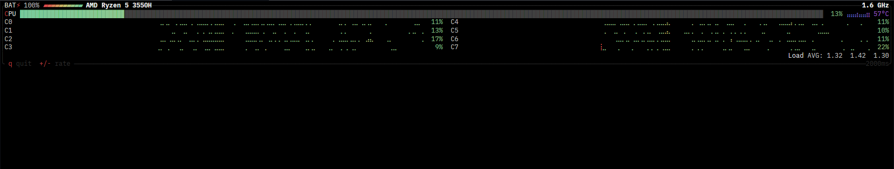

<p align="center">
  
</p>


---

A reimplementation of [btop](https://github.com/aristocratos/btop) in Rust, built on
[ratatui](https://ratatui.rs).

The goal is a resource monitor that feels like btop: the four-box layout, braille
graphs with gradient fills, mouse-driven navigation, and a themable process
manager, but written as a modern Rust TUI.

## Status

**macOS and Linux are supported.** CPU, memory, network, disk usage, process,
load-average, and battery data are sampled from each platform's native APIs.
CPU frequency and temperature are not currently available on Apple Silicon,
and macOS disk I/O rates are not reported yet.

The CPU box samples real data and renders btop's layout:



Per-core braille history graphs, a gradient load bar with sub-cell resolution,
frequency, package temperature, battery, and load averages.

Everything else, the memory, network, and process boxes, is still to come.

 
## Design notes

- **Data source:** Linux reads `/proc` and `/sys` directly. macOS uses Mach,
  sysctl, libproc, `getifaddrs`, `getmntinfo`, and IOKit's power-source APIs;
  neither platform shells out to external commands. btop's Linux collector is
  the reference where its data is available.
- **Graphs are the hard part.** btop's look comes from braille sub-cell plotting
  with a color gradient applied along the value axis, not from a stock chart
  widget. Expect a custom ratatui widget rather than `Sparkline`/`Chart`.
- **CPU and network values are deltas** between samples, so the collector retains
  previous counters per core, per interface, and per process — same as btop.
- **Rendering:** ratatui's immediate-mode draw loop. Keep collection off the
  render path so a slow `/proc` sweep never stalls input.
- **Layout:** four resizable boxes. btop lets the user toggle boxes on and off and
  reflows the rest, so the layout should be computed from an enabled-box set
  rather than hardcoded constraints.
 

## Getting started

```sh
make run        # launch it (q or Esc quits)
make test       # 46 tests
make ci         # fmt-check + clippy -D warnings + test
make snapshot   # print one frame as text, no terminal needed
make help       # every target
```

`make snapshot` is the quickest way to check layout changes — it dumps the
rendered buffer to stdout, so it works over a pipe and in CI.

Run a single test with `make test-one T=<name>`; `T` also accepts a module path,
so `make test-one T=widgets::braille` runs that whole module.
 

## since you've kept an eye this far — check out what I'm really cooking

I'm Maneshwar, and alongside ratatop I'm cooking [git-lrc](https://github.com/HexmosTech/git-lrc?utm_source=ratatop) — a micro AI code reviewer that runs on every commit.

It hooks into `git commit`, reviews every diff before it lands, and catches the bugs AI agents introduce silently. 60-second setup.

AI agents write code fast.

They also silently remove logic, change behavior, and introduce bugs — without telling you.

You often find out in production.

git-lrc fixes this.

Any feedback or contributors are welcome.

⭐ [Star git-lrc on GitHub](https://github.com/HexmosTech/git-lrc?utm_source=ratatop) to help other devs discover it.
